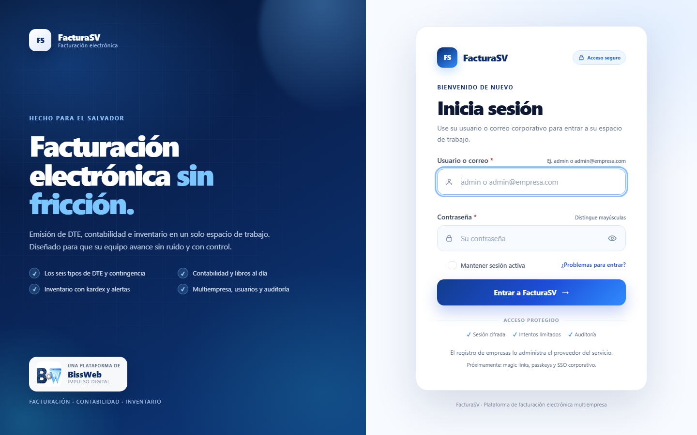
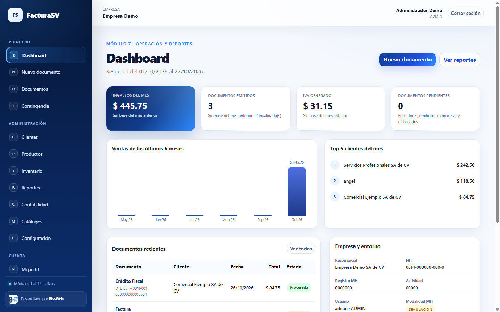
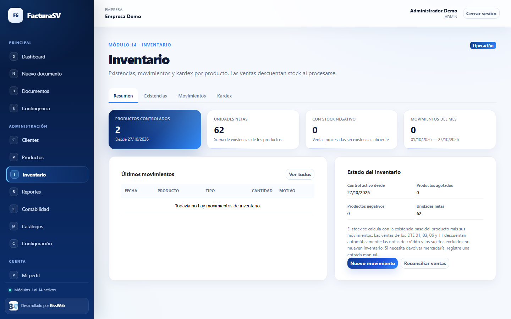
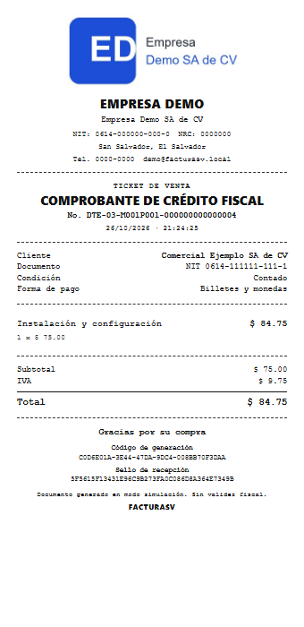
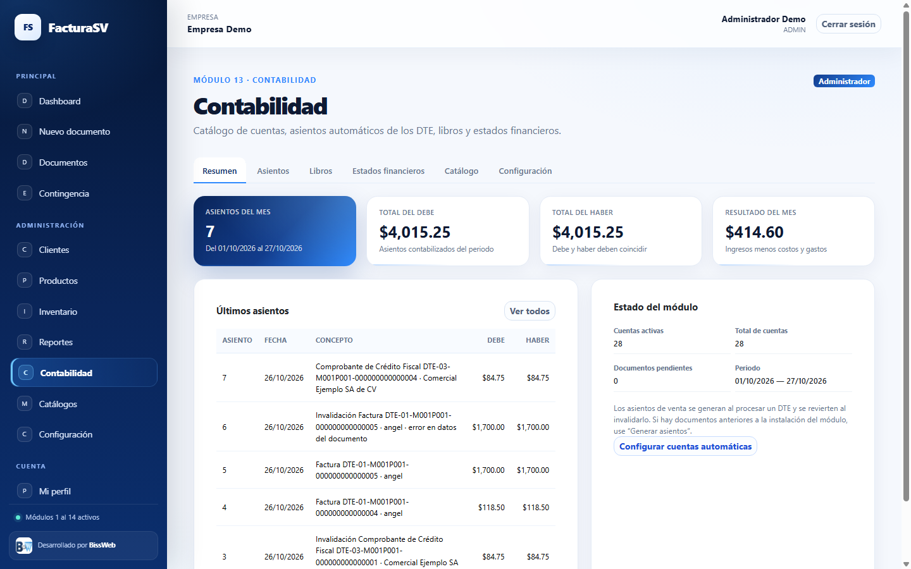

# Manual de usuario

## FacturaSV

**Sistema de facturación electrónica multiempresa para El Salvador**

Módulos 1 al 14 · Versión de esquema 15

Desarrollado por **BissWeb — Impulso Digital**

Octubre de 2026

<!-- contenido -->

## Contenido

1. Introducción
2. Requisitos y acceso
3. Roles y permisos
4. Navegación general
5. Catálogos del Ministerio de Hacienda
6. Clientes
7. Productos y servicios
8. Inventario
9. Emisión de documentos DTE
10. Documentos emitidos
11. Contingencia
12. Dashboard y reportes
13. Contabilidad
14. Configuración de la empresa
15. Superadministración
16. Mi perfil
17. Correo electrónico
18. Seguridad y buenas prácticas
19. Solución de problemas
20. Glosario
21. Anexos

<!-- pagebreak -->

# 1. Introducción

FacturaSV es una plataforma SaaS multiempresa para emitir Documentos Tributarios Electrónicos (DTE) de El Salvador, administrar clientes y productos, enviar los documentos por correo, consultar reportes, llevar contabilidad y controlar inventario.

Cada empresa tiene sus propios usuarios, clientes, productos, series, documentos, cuentas contables y movimientos de inventario. La información de una empresa no es visible para otra.

## 1.1 Alcance actual

La plataforma incluye:

- Emisión de Factura (01), Comprobante de Crédito Fiscal (03), Nota de Crédito (05), Nota de Débito (06), Factura de Exportación (11) y Factura de Sujeto Excluido (14).
- Representación gráfica PDF, impresión de ticket térmico de 58/80 mm, descarga del JSON, envío por correo e invalidación.
- Contingencia con evento del Ministerio de Hacienda (MH) y transmisión diferida.
- Dashboard, reportes y exportación CSV.
- Configuración de empresa, emisor, numeración, logo y correo.
- Superadministración de empresas y usuarios.
- Perfil de usuario con cambio de la propia contraseña.
- Contabilidad con catálogo de cuentas, asientos, libros, balanza y estados financieros.
- Inventario básico con movimientos, existencias y kardex.

> **Importante:** el conector con Hacienda está en modo **SIMULACIÓN**. No existe todavía una conexión real con el MH y el entorno `PRODUCCION` está bloqueado en Configuración. La firma y los sellos son simulados.

## 1.2 Lo que no incluye esta versión

- Conexión real con el Ministerio de Hacienda.
- Compras, proveedores y costo de venta dentro del inventario.
- Cierre de periodos contables.
- SSO/OAuth, passkeys y acceso por magic link.
- Recuperación automática de contraseña por correo.

# 2. Requisitos y acceso

## 2.1 Requisitos

- Navegador moderno con JavaScript habilitado (Chrome, Edge, Firefox o Safari recientes).
- Conexión a la red donde está publicado el sistema.
- Usuario activo y empresa activa.
- Para el envío real de correo: servidor SMTP configurado en el servidor.

## 2.2 URL de acceso

La instalación local de demostración está en:

`http://localhost/sistemas/factElectronica_saas/facturacion%20electronica/`

En producción se debe usar una URL HTTPS.

## 2.3 Credenciales demo

| Perfil | Usuario | Correo | Contraseña |
|---|---|---|---|
| Administrador de empresa | `admin` | `admin@facturasv.local` | `Demo1234!` |
| Superadministrador | `superadmin` | `superadmin@facturasv.local` | `SuperDemo1234!` |

> **Seguridad:** cambie las contraseñas demo antes de publicar el sistema. No utilice estas credenciales en un entorno real.

## 2.4 Iniciar sesión

1. Abra la URL del sistema.
2. Escriba su **usuario o correo electrónico**.
3. Escriba su contraseña.
4. Si lo desea, active **Mantener sesión activa**.
5. Pulse **Entrar a FacturaSV**.

La casilla **Mantener sesión activa** viene desmarcada por seguridad. Actívela solo en un equipo de confianza; extiende la sesión hasta 30 días. Si no la activa, la sesión termina al cerrar el navegador.

El botón del ojo permite **mostrar u ocultar la contraseña**. El sistema avisa si Bloq Mayús está activado y valida el formato del correo en tiempo real.

## 2.5 Problemas de acceso

El enlace **¿Problemas para entrar?** explica cómo solicitar el restablecimiento. Por seguridad, el sistema no envía contraseñas por correo. El administrador de la empresa o el superadministrador deben restablecerla.

Después de cinco intentos fallidos para el mismo usuario, el acceso se bloquea temporalmente durante 15 minutos. Un inicio de sesión correcto limpia los intentos fallidos de esa cuenta.

# 3. Roles y permisos

| Rol | Alcance | Puede hacer | No puede hacer |
|---|---|---|---|
| `SUPERADMIN` | Global, sin empresa | Crear y desactivar empresas; crear usuarios; restablecer contraseñas; consultar el panel global | Entrar al dashboard o a los datos de una empresa |
| `ADMIN` | Una empresa | Configurar empresa, emisor, series y correo; administrar catálogos, clientes, productos, contabilidad y su catálogo de cuentas; emitir, transmitir, invalidar y consultar | Crear o desactivar usuarios; cambiar su propio nombre, usuario, correo o rol |
| `VENDEDOR` | Una empresa | Emitir y transmitir DTE; administrar clientes y productos; registrar movimientos de inventario; consultar reportes | Configurar la empresa; modificar catálogos MH; invalidar documentos; modificar el catálogo contable |
| `CONTADOR` | Una empresa | Consultar documentos, reportes, contabilidad e inventario; registrar asientos manuales; exportar CSV | Emitir o transmitir DTE; invalidar; modificar catálogos, productos, clientes o inventario |

> **Nota:** la gestión de usuarios está centralizada en el superadministrador. El `ADMIN` de una empresa solo consulta la lista en **Configuración → Usuarios**.

# 4. Navegación general

La pantalla principal tiene un menú lateral y una barra superior.

- **Principal:** Dashboard, Nuevo documento, Documentos y Contingencia.
- **Administración:** Clientes, Productos, Inventario, Reportes, Contabilidad, Catálogos y Configuración.
- **Cuenta:** Mi perfil.
- **Barra superior:** empresa activa, usuario, rol y botón para cerrar sesión.
- **Móvil:** el botón de menú abre y cierra el panel lateral.

La visibilidad de algunas opciones depende del rol. Por ejemplo, `CONTADOR` no ve Nuevo documento y `VENDEDOR` no ve Contabilidad.

Los avisos de éxito aparecen como notificaciones breves; los errores se muestran en un recuadro rojo o junto al campo correspondiente.

# 5. Catálogos del Ministerio de Hacienda

El menú **Catálogos** permite consultar los valores oficiales de la empresa:

- Tipos de documento.
- Tipos de establecimiento.
- Tipos de ítem.
- Unidades de medida.
- Condiciones de operación.
- Formas de pago.
- Departamentos y municipios.

Solo el `ADMIN` puede crear, editar, activar o desactivar registros. Los catálogos se crean automáticamente al dar de alta una empresa.

> **Recomendación:** no desactive un catálogo que esté siendo usado por documentos, clientes o productos. Si necesita retirarlo, primero revise las relaciones.

# 6. Clientes

## 6.1 Crear un cliente

1. Abra **Clientes**.
2. Pulse **Nuevo cliente**.
3. Complete nombre, tipo y número de documento, actividad económica, dirección, departamento, municipio, teléfono y correo.
4. Seleccione el tipo de contribuyente.
5. Guarde.

## 6.2 Documento del cliente

- **NIT:** requerido para Crédito Fiscal y recomendado para empresas.
- **DUI:** válido para personas naturales.
- **Ninguno:** permite consumidor final en Factura. No se usa en Crédito Fiscal ni en los tipos 05, 06, 11 y 14.

El Crédito Fiscal exige NIT y correo electrónico. Las notas 05/06, la exportación 11 y el sujeto excluido 14 exigen NIT o DUI.

## 6.3 Importar y exportar

- **Exportar CSV** descarga el listado filtrado.
- **Importar CSV** acepta hasta 1000 clientes y 2 MB.
- La importación es atómica: si una fila falla, no se inserta ninguna y se indica el problema.
- Use la plantilla de columnas disponible en la pantalla.

## 6.4 Editar y desactivar

Puede editar los datos mientras el cliente exista. Si está relacionado con documentos, no se elimina físicamente: se desactiva para conservar el historial. El buscador acepta varias palabras, ignora mayúsculas y acentos y encuentra el documento aunque se escriba sin guiones.

# 7. Productos y servicios

## 7.1 Crear un producto o servicio

1. Abra **Productos**.
2. Pulse **Nuevo producto o servicio**.
3. Indique código, descripción, tipo (bien o servicio), unidad de medida, precio y tratamiento de IVA.
4. Opcionalmente, escanee o escriba el **código de barras**. Debe ser único dentro de la empresa y no puede contener espacios.
5. Si controla existencias, active **Controlar existencias** e indique la existencia inicial.
6. Guarde.

El código es único dentro de la empresa y admite letras, números, punto, guion y guion bajo.

## 7.2 Reglas de precio e IVA

- **Gravado (13 %):** el sistema calcula el IVA según el tipo de DTE.
- **Exento:** no genera IVA.
- **No sujeto:** no genera IVA y se informa como no sujeto.

En Factura (01) el precio se interpreta con IVA incluido. En Crédito Fiscal (03) el precio se interpreta sin IVA. En las notas, el tratamiento depende del documento relacionado.

## 7.3 Existencias

La existencia inicial se define al crear el producto. Después de creado, el campo de stock y el control de existencias se bloquean en la edición: los cambios se registran desde **Inventario → Movimientos**.

Si el producto no controla existencias, el stock queda sin controlar y no se descuenta al vender.

## 7.4 Eliminar o desactivar

Un producto relacionado con documentos o movimientos de inventario no se puede eliminar. Use **Desactivar** para retirarlo de nuevas operaciones sin perder el historial.

## 7.5 Código de barras y escaneo

Cada producto puede tener un código de barras (EAN-13, UPC, Code128 u otro). Sirve para buscarlo en el catálogo y para agregarlo a la factura con una pistola USB.

1. En **Productos**, edite el producto y complete **Código de barras**, o escanéelo con la pistola.
2. En **Nuevo documento**, ubique el cursor en **Escanear código de barras** y escanee el producto.
3. La primera vez se agrega una línea con cantidad 1 y el precio del catálogo. Si vuelve a escanear el mismo producto, la cantidad aumenta en 1.
4. Si el código no existe o el producto está inactivo, aparece un aviso y no se agrega la línea.
5. También puede escribir el código y presionar **Enter** o **Agregar**.

La pistola debe estar configurada como teclado y enviar **Enter** al final del código. No se requiere instalar controladores.

## 7.6 Búsqueda inteligente

Los buscadores de **Clientes**, **Productos** y **Catálogos** aceptan una o varias palabras en cualquier orden, sin distinguir mayúsculas ni acentos. Por ejemplo, `maria lopez` encuentra a María López y `inalambrico` encuentra el mouse inalámbrico.

- En clientes puede buscar por nombre, documento con o sin guiones, correo, teléfono o actividad.
- En productos puede buscar por código, código de barras o descripción.
- En catálogos puede buscar por código y nombre; en municipios también por departamento.
- Los resultados se actualizan mientras escribe; **Enter** o **Buscar** ejecutan la búsqueda de inmediato.

# 8. Inventario

El inventario es básico: controla cantidades, no costos ni compras.

## 8.1 Cómo se calcula la existencia

La existencia actual de un producto es:

**existencia base + suma de movimientos**

- Entradas y ajustes positivos suman.
- Salidas y ajustes negativos restan.
- La existencia base es el valor definido al crear el producto.
- No se actualiza un saldo mutable: el stock se calcula desde el libro de movimientos.

Esto permite que, al eliminar un documento de prueba o mantenimiento, sus movimientos se eliminen en cascada y el stock vuelva solo a su valor anterior.

## 8.2 Tipos de movimiento

| Movimiento | Efecto | Uso típico |
|---|---|---|
| Entrada | Suma | Compra, devolución o carga inicial |
| Salida | Resta | Consumo o venta manual |
| Ajuste positivo | Suma | Corrección por conteo físico |
| Ajuste negativo | Resta | Corrección por conteo físico |

Las salidas y ajustes negativos **manuales** no pueden dejar el stock en negativo. Las salidas automáticas de ventas sí pueden dejar stock negativo para no bloquear la emisión del DTE; la pantalla muestra una alerta.

## 8.3 Registrar un movimiento

1. Abra **Inventario → Movimientos**.
2. Pulse **Nuevo movimiento**.
3. Seleccione producto, tipo, fecha y cantidad.
4. Escriba un motivo claro.
5. Guarde.

La fecha no puede ser futura ni anterior a tres años. La cantidad admite hasta cuatro decimales. Los movimientos no se editan ni se eliminan: para corregir, registre el movimiento inverso.

## 8.4 Movimientos automáticos por venta

- Los DTE **01, 03, 06 y 11** descuentan existencias al pasar a **Procesada**.
- La invalidación de un DTE genera una entrada por cada salida original.
- Los DTE **05 (Nota de Crédito)** y **14 (Sujeto Excluido)** no mueven inventario. Si hay una devolución física, registre una entrada manual.
- Si un producto no controla existencias, no se descuenta.

## 8.5 Existencias y kardex

- **Existencias:** lista de productos controlados con código, unidad, stock actual, estado y último movimiento.
- **Kardex:** historial de un producto con saldo inicial, movimientos y saldo final.
- **Estado:** disponible, agotado o negativo.
- **CSV:** exporta existencias, movimientos o kardex.

## 8.6 Pendientes y reconciliación

Si un movimiento automático no se pudo generar, la pantalla muestra un aviso de **documentos pendientes de conciliar**. Un `ADMIN` puede pulsar **Reconciliar ventas** para regenerar los movimientos de los DTE procesados desde la fecha de inicio del inventario.

La reconciliación no reconstruye ventas anteriores a la activación del inventario. La existencia base debe representar el stock al momento de comenzar a usar el módulo.

# 9. Emisión de documentos DTE

## 9.1 Tipos disponibles

| Tipo | Nombre | Regla principal |
|---|---|---|
| 01 | Factura | Precios con IVA incluido |
| 03 | Comprobante de Crédito Fiscal | Precios sin IVA; cliente con NIT y correo |
| 05 | Nota de Crédito | Requiere documento relacionado procesado |
| 06 | Nota de Débito | Requiere documento relacionado procesado |
| 11 | Factura de Exportación | Sin IVA; incluye flete y seguro |
| 14 | Factura de Sujeto Excluido | Compra sin IVA; descuenta retención de renta |

## 9.2 Crear un documento

1. Abra **Nuevo documento**.
2. Seleccione el tipo de DTE.
3. Seleccione el cliente.
4. Indique fecha, condición de operación y forma de pago.
5. Si es crédito, indique los días de plazo.
6. Agregue los ítems con cantidad, precio y descuento, o escanee el código de barras en la barra superior. El selector de producto tiene un buscador: escriba código, descripción o código de barras, elija con las flechas y Enter o con el mouse.
7. Para notas 05/06, seleccione el documento relacionado.
8. Para exportación, complete país, tipo de persona, incoterm, flete y seguro.
9. Para sujeto excluido, indique la retención de renta.
10. Revise observaciones y totales.
11. Guarde el borrador o emita y transmita.

## 9.3 Borrador y emisión

- **Guardar borrador:** permite editar sin consumir correlativo.
- **Emitir y transmitir:** reserva el número de control, genera el UUID, valida el JSON contra el esquema, firma y transmite en modo simulación.
- El correlativo se consume al emitir, no al guardar.
- Un borrador se puede eliminar. Un documento procesado no se elimina: se invalida.

## 9.4 Impuestos y retenciones

- **IVA retenido 1 %:** se aplica si la operación lo requiere; se refleja en el resumen y en la contabilidad.
- **Retención de renta:** aplica al sujeto excluido.
- **Exportación:** el total incluye flete y seguro; no se agrega IVA.
- Los ítems conservan hasta 8 decimales; el resumen se redondea a 2.

## 9.5 Resultado de la emisión

Al procesarse, el documento:

- Cambia a **Procesada**.
- Recibe un sello de recepción simulado.
- Genera su asiento contable automático.
- Descuenta inventario si corresponde.
- Prepara el correo al cliente con PDF y JSON.
- Registra el historial de transmisión.

Si el correo falla, el DTE no se revierte. El error queda en el historial y se puede reenviar.

## 9.6 Modo interno por empresa

El superadministrador puede poner una empresa en **modo interno** desde **Superadministración → Modo**. En ese modo la empresa no emite DTE: emite **comprobantes internos** de venta para control propio.

- El tipo de documento es **Comprobante interno (IN)** y usa una serie propia, por ejemplo `INT-000001`.
- No se genera código de generación, sello, JSON DTE ni transmisión al Ministerio de Hacienda.
- No se envía correo fiscal automático.
- Sí descuenta inventario y genera el asiento contable de venta, para que el control interno cuadre.
- El PDF y el ticket llevan la leyenda **COMPROBANTE INTERNO · NO FISCAL**.
- Un `ADMIN` puede **anular** el comprobante con un motivo; la anulación revierte inventario y contabilidad, sin evento ante Hacienda.
- Si la empresa vuelve a **simulación**, sus comprobantes internos se conservan como historial y no se convierten en DTE.

Un comprobante interno **no es una factura** ni sustituye las obligaciones tributarias de la empresa. No debe usarse para ocultar ventas.

# 10. Documentos emitidos

En **Documentos** puede:

- Filtrar por fecha, tipo, estado y cliente.
- Abrir el detalle con ítems, totales, JSON y logs.
- Descargar el PDF o el JSON.
- Consultar el estado en Hacienda (simulación).
- Reintentar la transmisión de un documento emitido o rechazado.
- Reenviar el correo al cliente.

## 10.1 Invalidación

Solo un `ADMIN` puede invalidar un documento **procesado con sello**. Debe indicar:

- Tipo de anulación.
- Motivo entre 5 y 200 caracteres.
- Tipo y número de documento del responsable.

La invalidación conserva el documento, genera el evento y revierte contabilidad e inventario. No borra el DTE.

## 10.2 Impresión de ticket

Los documentos procesados se pueden imprimir en formato de ticket térmico de **80 mm** o **58 mm**. El botón **Ticket** aparece en la lista de documentos y en el detalle. Los comprobantes internos también se pueden imprimir como ticket, con la marca **COMPROBANTE INTERNO · NO FISCAL**. Los DTE incluyen el **código QR** de consulta pública, que también aparece en el PDF; los comprobantes internos no tienen QR fiscal.

1. Abra **Documentos** y localice un DTE procesado.
2. Pulse **Ticket**.
3. En la barra superior elija **80 mm** o **58 mm**.
4. Pulse **Imprimir**.
5. En el diálogo del navegador seleccione la impresora térmica, configure el papel del mismo ancho, escala 100 % y desactive encabezados y pies del navegador.

El ticket incluye empresa, NIT/NRC, dirección, teléfono, tipo de documento, número de control, fecha y hora, cliente, ítems, totales, IVA, retención cuando aplica, forma de pago, código de generación, sello de recepción y el código QR de consulta.

Si el documento está invalidado, el ticket muestra **DOCUMENTO INVALIDADO**. Si se emitió en contingencia, muestra **EMITIDO EN CONTINGENCIA**. El ticket no sustituye el PDF oficial del DTE y, en modo simulación, no tiene validez fiscal.

# 11. Contingencia

Use contingencia cuando no sea posible transmitir al MH en el momento de la venta.

1. Abra **Contingencia**.
2. Defina el periodo, tipo de contingencia, motivo y responsable.
3. Seleccione los DTE emitidos en contingencia.
4. Genere el evento.
5. Procese el evento para transmitir los DTE pendientes.

Tipos de contingencia:

1. MH.
2. Emisor.
3. Internet.
4. Energía.
5. Otro (motivo obligatorio, máximo 500 caracteres).

El evento admite hasta 1000 DTE y solo incluye el tipo seleccionado. Un DTE solo puede pertenecer a un evento. Mientras el evento no se procese, los DTE quedan emitidos en contingencia y pueden descargarse en PDF.

# 12. Dashboard y reportes

## 12.1 Dashboard

Muestra:

- Ingresos del mes.
- Documentos emitidos.
- IVA generado.
- Documentos pendientes.
- Ventas de los últimos seis meses.
- Top 5 clientes.
- Documentos recientes.
- Datos de la empresa y progreso de módulos.

## 12.2 Reportes

Permite filtrar por rango de fechas y consultar:

- Resumen de ventas.
- Ventas por cliente.
- Ventas por producto.
- Resumen mensual de IVA.
- Ventas por día.

Solo se suman documentos **procesados**. Los borradores, rechazados e invalidados se informan por separado. Las notas de crédito restan de las ventas.

Cada reporte se puede exportar a CSV.

# 13. Contabilidad

## 13.1 Catálogo de cuentas

Cada empresa nace con 28 cuentas base de activo, pasivo, patrimonio, ingreso, costo y gasto. El `ADMIN` puede:

- Crear cuentas.
- Editar nombre, tipo y naturaleza.
- Activar o desactivar cuentas.
- Consultar el catálogo.

El código de una cuenta no se puede cambiar después de crearla. Una cuenta con movimientos no se desactiva ni cambia de tipo o naturaleza. Una cuenta usada en la configuración automática no se desactiva.

## 13.2 Configuración automática

En **Contabilidad → Configuración** se asignan las cuentas para:

- Caja y bancos.
- Cuentas por cobrar.
- Ventas gravadas, exentas y no sujetas.
- Exportaciones.
- Devoluciones y descuentos.
- IVA débito.
- IVA retenido por cobrar.
- Compras.
- Cuentas por pagar.
- Retención de renta por pagar.

El sistema valida que la cuenta exista, esté activa, permita movimientos y sea del tipo correcto.

## 13.3 Asientos automáticos

| Documento | Asiento |
|---|---|
| 01, 03, 06 | Venta: cobro, ingresos, IVA débito e IVA retenido |
| 05 | Nota de crédito: devolución, reverso de IVA y crédito al cliente |
| 11 | Exportación: cobro e ingreso por exportación |
| 14 | Compra: compras, cuenta por pagar y retención de renta |
| Invalidación | Contra-asiento que revierte el asiento original |

Los asientos automáticos son idempotentes: no se duplican si se reintenta la operación.

## 13.4 Asientos manuales

1. Abra **Contabilidad → Asientos**.
2. Pulse **Nuevo asiento**.
3. Indique fecha y concepto.
4. Agregue al menos dos líneas con cuenta, detalle, debe o haber.
5. Verifique que el debe sea igual al haber.
6. Guarde.

Un asiento manual se puede anular con un motivo. Los asientos automáticos no se anulan desde la interfaz: se revierten invalidando el DTE.

## 13.5 Libros y estados

- **Libro diario:** asientos con sus partidas.
- **Libro mayor:** movimientos y saldo por cuenta.
- **Balanza de comprobación:** sumas y saldos por cuenta.
- **Estado de resultados:** ingresos, costos, gastos, utilidad bruta y neta.
- **Balance general:** activo, pasivo, patrimonio y resultado del ejercicio calculado.

Los asientos anulados no se incluyen en libros, balanza ni estados. Se pueden exportar a CSV.

## 13.6 Pendientes

Si un DTE procesado no tiene asiento, aparece un aviso de **documentos pendientes**. El `ADMIN` o `CONTADOR` puede pulsar **Generar asientos** para contabilizar los DTE anteriores a la instalación o reparar un fallo.

# 14. Configuración de la empresa

Solo el `ADMIN` accede a **Configuración**.

- **Empresa:** razón social, nombre comercial, NIT, NRC, actividad, teléfono, correo, dirección y logo.
- **Emisor y DTE:** establecimiento, punto de venta, departamento, municipio, distrito, zona horaria y modalidad MH.
- **Numeración:** prefijo, número inicial, número actual y estado de cada serie.
- **Usuarios:** lista en modo solo lectura; la gestión la hace el superadministrador.
- **Correo:** estado del transporte, remitente y prueba de envío.
- **Historial:** cambios auditados.

El entorno `PRODUCCION` está bloqueado hasta implementar la conexión real con Hacienda.

# 15. Superadministración

El superadministrador es un usuario global sin empresa. Desde su panel puede:

- Crear una empresa con su primer `ADMIN`.
- Crear usuarios `ADMIN`, `VENDEDOR` o `CONTADOR`.
- Activar o desactivar usuarios.
- Restablecer contraseñas.
- Desactivar o reactivar empresas.

Al crear una empresa se generan sus catálogos MH, sus seis series, su catálogo contable y su configuración de inventario.

La desactivación de una empresa es lógica: conserva todos los datos, pero sus usuarios no pueden iniciar sesión. El registro público está cerrado; no hay auto-registro de empresas.

El superadministrador no puede entrar al dashboard ni a la contabilidad o inventario de una empresa.

# 16. Mi perfil

Cada usuario, incluido el superadministrador, puede abrir **Mi perfil** y:

- Consultar nombre, usuario, correo, rol, empresa/NIT y último acceso.
- Cambiar únicamente su propia contraseña.

Para cambiar la contraseña se exige la contraseña actual, la nueva y la confirmación. La nueva debe tener al menos 10 caracteres, mayúsculas, minúsculas y números, y no puede ser igual a la actual. El cambio queda auditado en la empresa.

No se puede cambiar nombre, usuario, correo, rol ni empresa desde el perfil. Tampoco se puede cambiar la contraseña de otro usuario.

# 17. Correo electrónico

## 17.1 Modo simulado

Por defecto, el sistema está en modo **simulado**:

- Prepara el mensaje con PDF y JSON.
- Registra el envío en el historial del documento.
- No contacta ningún servidor SMTP.
- No envía correos a los clientes.

Es el modo recomendado para desarrollo y pruebas.

## 17.2 Configurar envío real

Use variables de entorno en Apache:

- `MAIL_TRANSPORT=smtp`
- `MAIL_HOST`
- `MAIL_PORT`
- `MAIL_USER`
- `MAIL_PASS`
- `MAIL_ENCRYPTION=tls`
- `MAIL_FROM`
- `MAIL_FROM_NAME`

También puede crear `config/correo.local.php` a partir de `config/correo.local.example.php`. Ese archivo está bloqueado por web y excluido en `.gitignore`; no lo comparta ni lo versione.

## 17.3 Mailtrap

Mailtrap Sandbox captura los correos en una bandeja de pruebas. Para envío real se requiere un dominio verificado y un token de API. El plan Sandbox puede responder `550 Too many emails per second`; espere y reintente.

## 17.4 Historial

Cada documento muestra los envíos con destinatario, copia, asunto, transporte, estado y error. Un fallo de correo no revierte el DTE.

# 18. Seguridad y buenas prácticas

- Use contraseñas largas y distintas; no comparta credenciales.
- Cierre sesión al terminar, especialmente en equipos compartidos.
- Deje **Mantener sesión activa** desmarcada en equipos compartidos.
- Use HTTPS en producción.
- Mantenga respaldos de la base de datos y de `uploads/logos/`.
- No publique `config/correo.local.php` ni variables `MAIL_*`.
- Cambie las credenciales demo antes de publicar.
- Asigne a cada usuario el rol mínimo necesario.
- No elimine documentos procesados: use la invalidación.
- Revise los avisos de contabilidad e inventario pendientes.
- Supervise los intentos fallidos y la auditoría de configuración.
- Ante una sospecha de acceso indebido, cambie la contraseña y revise los usuarios activos.

# 19. Solución de problemas

| Problema | Causa probable | Acción |
|---|---|---|
| No puedo iniciar sesión | Usuario/correo o contraseña incorrectos, cuenta o empresa inactiva | Verifique los datos; consulte al administrador |
| “Demasiados intentos fallidos” | Cinco fallos en 15 minutos | Espere 15 minutos o pida al administrador |
| No recibo el correo | Transporte simulado o cliente sin correo | Revise el historial; configure SMTP; agregue correo al cliente |
| Mailtrap responde 550 | Límite de correos por segundo | Espere unos segundos y reintente |
| El CCF no se emite | Cliente sin NIT o sin correo | Complete los datos del cliente |
| La nota no se emite | Documento relacionado no procesado o de otro cliente | Seleccione una Factura o CCF procesado del mismo cliente |
| El DTE queda rechazado | Error de transmisión simulado | Revise el detalle y use Transmitir para reintentar |
| No aparece el PDF | Documento en borrador | Emita primero el DTE |
| No puedo eliminar un documento | Está procesado | Use Invalidar; solo se eliminan borradores |
| No puedo eliminar un producto | Tiene documentos o movimientos | Desactívelo |
| El stock está negativo | Venta automática sin existencia suficiente | Registre una entrada o ajuste; revise existencias |
| Hay documentos pendientes de contabilidad | Falló el asiento automático o es anterior al módulo | Use Generar asientos |
| Hay documentos pendientes de inventario | Falló el movimiento automático | Use Reconciliar ventas |
| “Sesión de seguridad expiró” | Token CSRF vencido o página vieja | Recargue la página e intente de nuevo |
| Acceso denegado 403 | El rol no permite la acción | Use una cuenta con el rol adecuado |
| No puedo activar PRODUCCION | La conexión real con MH no está implementada | Permanezca en SIMULACION |

# 20. Glosario

| Término | Significado |
|---|---|
| DTE | Documento Tributario Electrónico |
| MH | Ministerio de Hacienda |
| CCF | Comprobante de Crédito Fiscal |
| NC / ND | Nota de Crédito / Nota de Débito |
| FEX / FSE | Factura de Exportación / Factura de Sujeto Excluido |
| NIT | Número de Identificación Tributaria |
| DUI | Documento Único de Identidad |
| IVA | Impuesto al Valor Agregado |
| Retención de renta | Retención aplicada en el sujeto excluido |
| Kardex | Historial de movimientos y saldo de un producto |
| Asiento | Registro contable con partidas de debe y haber |
| Partida doble | Principio por el que el debe iguala al haber |
| Balanza | Resumen de sumas y saldos por cuenta |
| Tenant | Empresa dentro de la plataforma multiempresa |
| SaaS | Software como servicio |
| SSO | Inicio de sesión único corporativo |
| Passkey | Credencial de acceso sin contraseña basada en el dispositivo |
| Magic link | Enlace de acceso enviado por correo |

# 21. Anexos

## 21.1 Datos de la instalación demo

- Empresa: Empresa Demo SA de CV.
- NIT: `0614-000000-000-0`.
- Establecimiento: `M001P001`.
- Zona horaria: `America/El_Salvador`.
- Moneda: USD.
- Modalidad: SIMULACION.
- Documentos demo: 5 (tres procesados y dos invalidados).
- Cuentas contables: 28.
- Productos con inventario: `PROD-001` (12 unidades) y `PROD-002` (50 unidades).

## 21.2 Pruebas automatizadas

Desde la raíz del proyecto, con Apache y MySQL activos:

`php tests/module5-smoke.php`

`php tests/module5-http.php`

`php tests/module6-pdf.php`

`php tests/module6-http.php`

`php tests/module7-smoke.php`

`php tests/module7-smtp.php`

`php tests/module7-http.php`

`php tests/module8-smoke.php`

`php tests/module8-http.php`

`php tests/module9-smoke.php`

`php tests/module9-http.php`

`php tests/module10-smoke.php`

`php tests/module10-http.php`

`php tests/module11-smoke.php`

`php tests/module11-http.php`

`php tests/module12-smoke.php`

`php tests/module12-http.php`

`php tests/module13-smoke.php`

`php tests/module13-http.php`

`php tests/module14-smoke.php`

`php tests/module14-http.php`

`php tests/ticket-smoke.php`

`php tests/ticket-http.php`

Al cierre de esta versión: **601 comprobaciones correctas**. Algunas pruebas requieren permisos de escritura en `uploads/logos` y `tests/`; en un entorno confinado deben ejecutarse con acceso completo.

## 21.3 Soporte

Para soporte técnico, contacto con **BissWeb — Impulso Digital**.

Antes de reportar un problema, incluya:

- Usuario y empresa afectada.
- Fecha y hora.
- Documento o pantalla.
- Mensaje de error.
- Captura de pantalla, si es posible.

No incluya contraseñas ni credenciales SMTP en el reporte.
